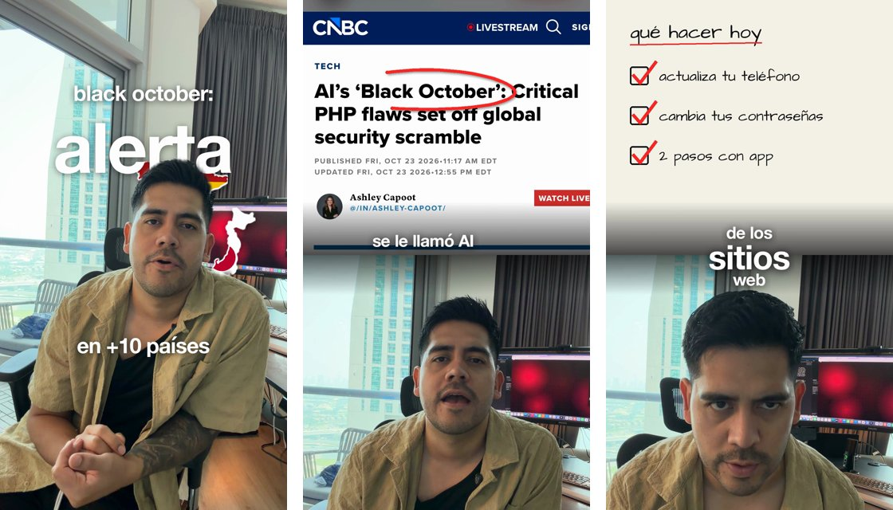

# claude-captions

Una skill para **Claude Code** que edita tus videos verticales (Reels, TikTok, Shorts) con captions estilo Helvetica:
palabras en minúscula que aparecen una por una, una palabra clave grande por frase y el hook **detrás de tu cabeza**.
También agrega B-roll con círculos rojos y notas a mano, pantalla dividida, mapas de países que pasan detrás de ti y un checklist animado.



Todo corre en tu computadora con Python y ffmpeg. No es IA que inventa video: Claude edita **tu propio video** con código.

## Qué necesitas

- [Claude Code](https://claude.com/claude-code) (la app de escritorio en la pestaña Code, o la terminal). No funciona en el chat normal de Claude.
- Python 3.10, 3.11 o 3.12.
- ffmpeg: en Mac `brew install ffmpeg`; en Windows `winget install Gyan.FFmpeg`.
- git.

## Instalación

**Mac**
```bash
git clone https://github.com/abrahamolverad/claude-captions ~/.claude/skills/captions
```

**Windows (PowerShell)**
```powershell
git clone https://github.com/abrahamolverad/claude-captions $HOME\.claude\skills\captions
```

Reinicia Claude Code. La primera vez que la uses, Claude instala lo que falta: unos minutos, y la descarga del modelo de transcripción (~0.5 GB).

## Cómo se usa

Abre Claude Code en la carpeta de tu video y escríbele, por ejemplo:

- «Usa la skill captions con `mi-video.mp4`. Quita las partes donde me equivoco y ponle captions.»
- «El hook en pantalla que diga: *esto cambió / todo / en 24 horas*, con la palabra grande detrás de mi cabeza.»
- «Pon esta captura arriba en pantalla dividida cuando digo "Black October" y encierra en rojo el titular.»
- «Cuando digo los países, que pasen sus mapas detrás de mí.»
- «En la parte de qué hacer, pon un checklist que se vaya palomeando.»

O usa los comandos cortos:

| Comando | Qué hace |
|---|---|
| `/captions mi-video.mp4` | Edición completa: quita errores, captions palabra por palabra y hook |
| `/captions hook mi-video.mp4 "esto cambió / TODO / en 24 horas"` | Ese hook desde el primer segundo, la palabra grande detrás de tu cabeza |
| `/captions mapas mi-video.mp4 España, Japón, México` | Los mapas pasan detrás de ti cuando dices cada país |
| `/captions split mi-video.mp4 captura.png "texto a encerrar"` | Pantalla dividida con la captura arriba y un círculo rojo |
| `/captions circulo mi-video.mp4 captura.png "texto" "nota"` | La captura a pantalla completa con círculo y nota a mano |
| `/captions checklist mi-video.mp4 paso 1; paso 2; paso 3` | Un checklist que se palomea |
| `/captions detras mi-video.mp4 "PALABRA"` | Una palabra grande detrás de tu cabeza |

| `/captions dictado mi-video.mp4` | Modo dictado: tú dices la edición en cámara y Claude la ejecuta (abajo) |

Claude te deja `work/final.mp4` y te dice qué cortó. La música agrégala en Instagram o TikTok, desde su biblioteca con licencia.

## Modo dictado: dile la edición mientras grabas

Graba tu video y, mientras hablas, di cada orden en el momento en que la quieres. Claude transcribe, quita tus dudas y repeticiones
y aplica cada orden justo donde la dijiste:

- «ponle captions» · «pon el color azul» (colorea esa palabra) · «haz un close in» y «close out»
- «subtítulos en japonés, hindi e inglés» · «pon la bandera de México aquí» (la pone donde señalas)
- «corta la escena» · «hazme en blanco y negro» · «pon música» y «cambia la música» (con tus canciones con licencia en `music/`)
- «pon números» y la cifra («un millón de followers») · «ponle un icono de gente»
- un hook con tu frase repartida alrededor de ti y tu mascota o logo sin fondo

```
/captions dictado mi-video.mp4
```

Si te equivocas al grabar, repite la orden: Claude se queda con la última versión. Lo que no esté en la lista pídelo con palabras al final.

## Qué incluye

| Script | Qué hace |
|---|---|
| `transcribe.py` | Transcripción palabra por palabra (faster-whisper) para elegir las mejores tomas |
| `cut.py` | Quita pausas y tomas repetidas, zoom suave en cortes alternos, voz a -16 LUFS |
| `mask.py` | Silueta de la persona en cada cuadro (Apple Vision en Mac, MediaPipe en Windows) |
| `broll.py` | Capturas o footage con cámara, círculos rojos, notas a mano, difuminado y checklist |
| `maps.py` | Siluetas de países con bandera (si es simple) y nombre |
| `render.py` | Captions (con palabras de color si lo pides), hook detrás de la cabeza, mapas flotantes, B-roll y efectos de sonido |
| `fx.py` | Close in / close out, blanco y negro, corte a negro y tintes sobre el video ya cortado |
| `overlay.py` | Subtítulos en otros idiomas, banderas y stickers, contadores con icono y música que cambia cuando lo dices |
| `frames.py`, `grid.py` | Revisión cuadro por cuadro y coordenadas sobre capturas |

En Mac usa Helvetica Neue del sistema; en Windows y Linux usa Inter (libre), que se ve muy parecida.

## Buenas prácticas

- El hook tiene que frenar el scroll **y** ser verdad: no prometas lo que el video no muestra.
- Usa capturas y footage que puedas usar, y da crédito a las fuentes en el texto del post.
- Difumina datos privados: nombres, correos, caras de personas que no son públicas y saldos.

---

### English

A Claude Code skill that turns a talking-head video into a vertical Reel with minimalist lowercase captions (one big key word per phrase,
hook text behind your head), plus B-roll with hand-drawn circles and notes, split screen, floating country maps and an animated checklist.
Dictation mode: say the edit on camera ("add captions", "make this word blue", "zoom in", "subtitles in Japanese", "put the Mexican flag here", "cut", "black and white", "play music", "one million followers") and Claude cuts your hesitations and executes each command where you said it (`/captions dictado my-video.mp4`).
Install with `git clone https://github.com/abrahamolverad/claude-captions ~/.claude/skills/captions`, restart Claude Code and ask:
"Use the captions skill on my-video.mp4". Requires Python 3.10–3.12 and ffmpeg. Runs locally; it edits your own footage, it doesn't generate video.

Hecho por [Abraham Olvera](https://abrahamolvera.ai) · Instagram [@abrahamolvera.ai](https://www.instagram.com/abrahamolvera.ai/) · Licencia MIT (ver `THIRD_PARTY.md` para fuentes, modelo y mapas).
